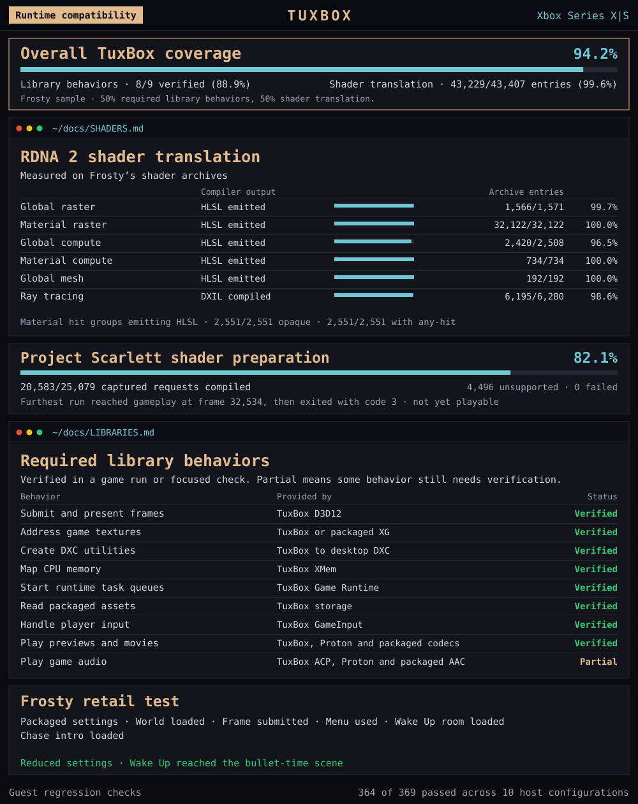

# TuxBox

TuxBox is an experimental project for running Xbox Series X|S games on PC. Most testing happens on Linux with Proton. Windows support is also in development.

## What runs today?

- **Lanes** is a small game included with TuxBox. Collect coins and dodge barriers using a keyboard, mouse or Xbox controller.
- **The Matrix Awakens (Frosty)** opens its menu and plays the opening chase cutscenes on Linux. It needs the original game files and extra libraries. The 3D chase scenes are still almost black. We haven’t confirmed that driving or shooting works yet. [Setup and test results](docs/MATRIX_AWAKENS.md)

## Try Lanes

Once the build tools are installed, run these commands from the project folder. [Build requirements](examples/lanes/README.md#build-requirements)

```sh
python -m pip install -r requirements.txt
python build.py lanes
python tuxbox.py run --app-id Lanes build/lanes
```

Press Left or Right to change lanes, or Space to take a turn in your current lane. R restarts the game and Escape quits.

## Compatibility

[](docs/progress.svg)

[Xbox library support](docs/LIBRARIES.md) · [Results by system](docs/RESULTS.md) · [How TuxBox works](docs/ARCHITECTURE.md) · [Project credits and references](docs/REFERENCES.md)
